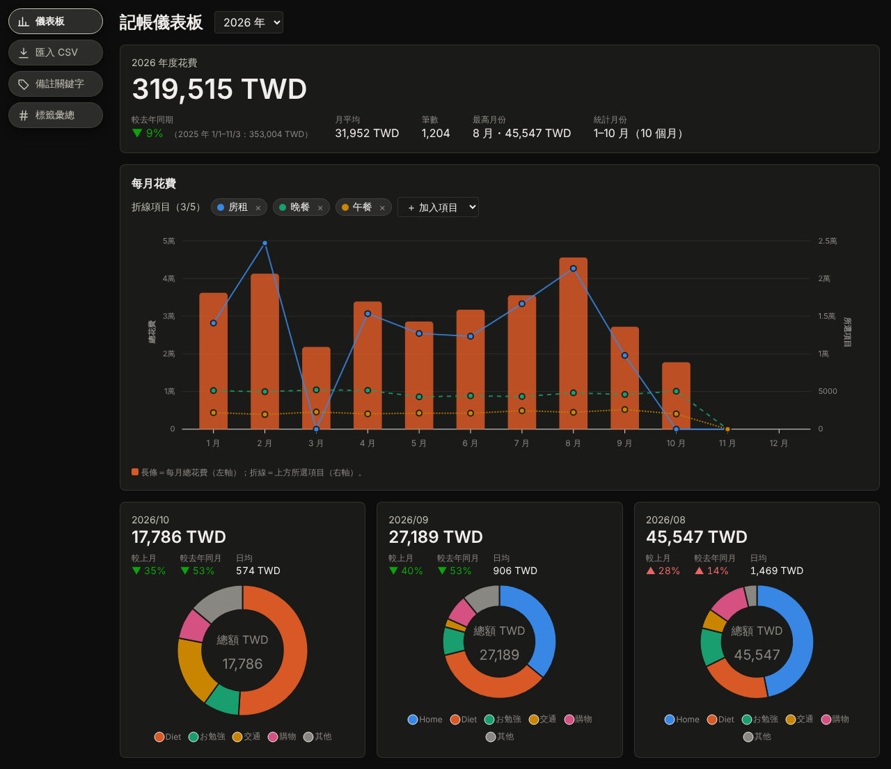

# 記帳儀表板（ExpenseDashboard）

把 iPhone 記帳 App **「天天記帳」**（僅 iOS）匯出的 CSV 匯入，在電腦瀏覽器上用圖表看自己的花費：每年花多少、每月花在哪裡、和去年比是多還是少。

- 📱 資料來源：[天天記帳 簡單 實用的記帳本（App Store）](https://apps.apple.com/tw/app/id954944283)
- 💻 在自己的電腦上執行，資料只存在本機（SQLite），不會上傳到任何地方
- 🌙 暗色介面、中文介面，手機瀏覽器也能看



## 功能

| 頁面 | 可以做什麼 |
|---|---|
| **儀表板** | 年度花費總額與「較去年同期」；1–12 月每月花費長條圖，可再疊加最多 5 條折線（某個類別、大類別或備註關鍵字的每月金額）；每月一張小卡，顯示總額、較上月、較去年同月、日均與大類別圓餅圖 |
| **匯入 CSV** | 匯入「天天記帳」的匯出檔；重複匯入不會產生重複資料，在 App 裡修改過的紀錄會自動更新，並列出改了哪些欄位；可選擇同步刪除在 App 裡已刪掉的紀錄（會先預覽、確認後才刪） |
| **備註關鍵字** | 用備註裡的字自訂分類，例如把備註含「GPT」「CLAUDE CODE」的支出歸成「AI 服務」，再加到儀表板的折線圖 |
| **標籤彙總** | 依 App 的「標籤」欄位，列出每個標籤一年花了多少、每月多少 |

> 目前只統計**支出**；收入紀錄會被匯入，但不列入圖表。

## 支援的匯入格式

以 **「天天記帳」App 匯出的 CSV** 為準，新舊兩版格式都可以：

```
日期,類別,大類別,金額,幣別,成員,帳戶,標籤,備註,收支區分,上次更新,UUID
20250210,遊戲,,300,TWD,自己,現金,休閒,"Steam, 特價",支,2025-02-10 21:05:11,5E6F7081-...
```

- 舊版的「貨幣」欄、新版的「幣別」欄都認得；舊版沒有「標籤」欄也沒關係。
- 欄位順序不影響；格式有誤的列會略過，並告訴你是第幾行、哪裡錯。
- 其他記帳 App 的 CSV 只要欄位名稱與上面相同也能匯入，但沒有特別支援。

範例檔（虛構資料）：[`sample-export.csv`](tests/ExpenseDashboard.Tests/TestData/sample-export.csv)（舊版）、[`sample-export-v2.csv`](tests/ExpenseDashboard.Tests/TestData/sample-export-v2.csv)（新版）。

## 開始使用

需要 [.NET 10 SDK](https://dotnet.microsoft.com/download/dotnet/10.0)。

1. 下載這個專案後，在專案資料夾執行：

   ```bash
   dotnet run --project src/ExpenseDashboard.Web
   ```

   或用 **Visual Studio 2026** 開啟 `ExpenseDashboard.slnx`，選 `https` 啟動設定後按 F5（Visual Studio 2022 不支援 .NET 10）。
2. 瀏覽器打開終端機顯示的網址（例如 `http://localhost:5286`）。
3. 在「天天記帳」App 匯出 CSV，傳到電腦後，到左上角「**匯入 CSV**」選擇檔案。
4. 回到「**儀表板**」就能看到圖表。之後每次在 App 匯出新的檔案再匯入即可，舊資料會自動合併。

資料庫檔案在 `src/ExpenseDashboard.Web/App_Data/expenses.db`，複製這個檔案就是完整備份；刪掉它就會重新開始。

## 技術

.NET 10 Blazor Web App（Interactive Server）、EF Core + SQLite、[Blazor-ApexCharts](https://github.com/apexcharts/Blazor-ApexCharts)，測試使用 xUnit 與 bUnit：

```bash
dotnet test
```

開發說明見 [CLAUDE.md](CLAUDE.md)，已知限制與待辦見 [PROGRESS.md](PROGRESS.md)。

> 本專案與「天天記帳」App 開發者無關，只是讀取它的匯出檔。
